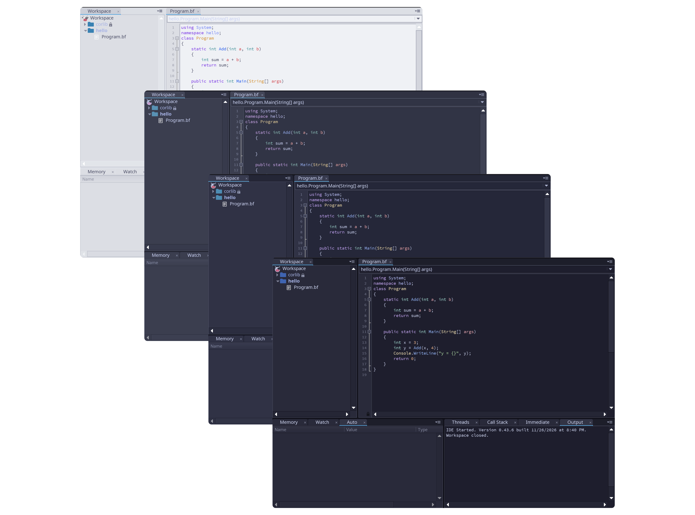
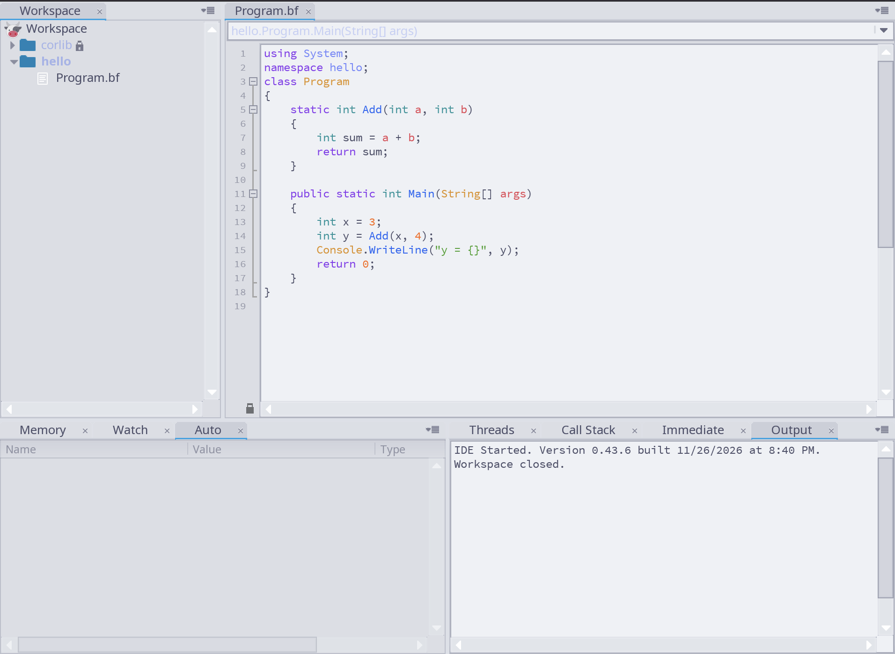
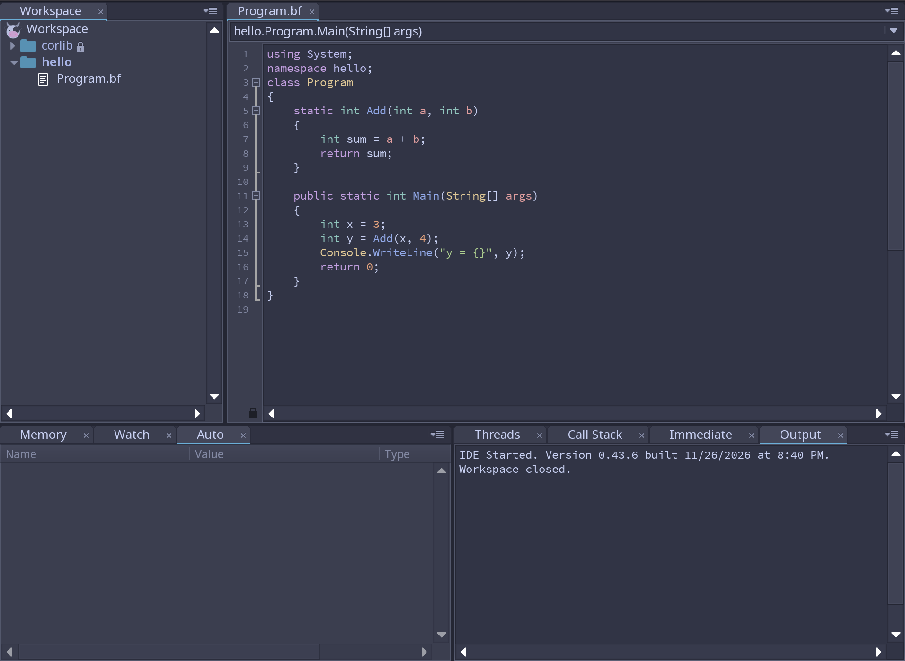
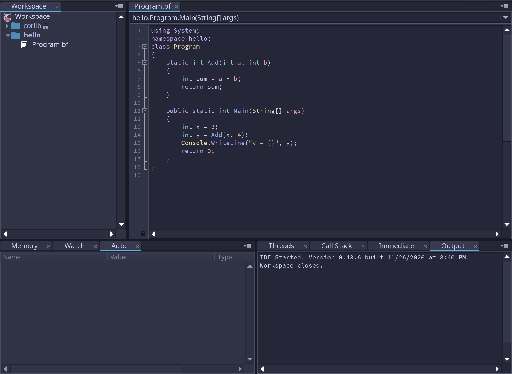
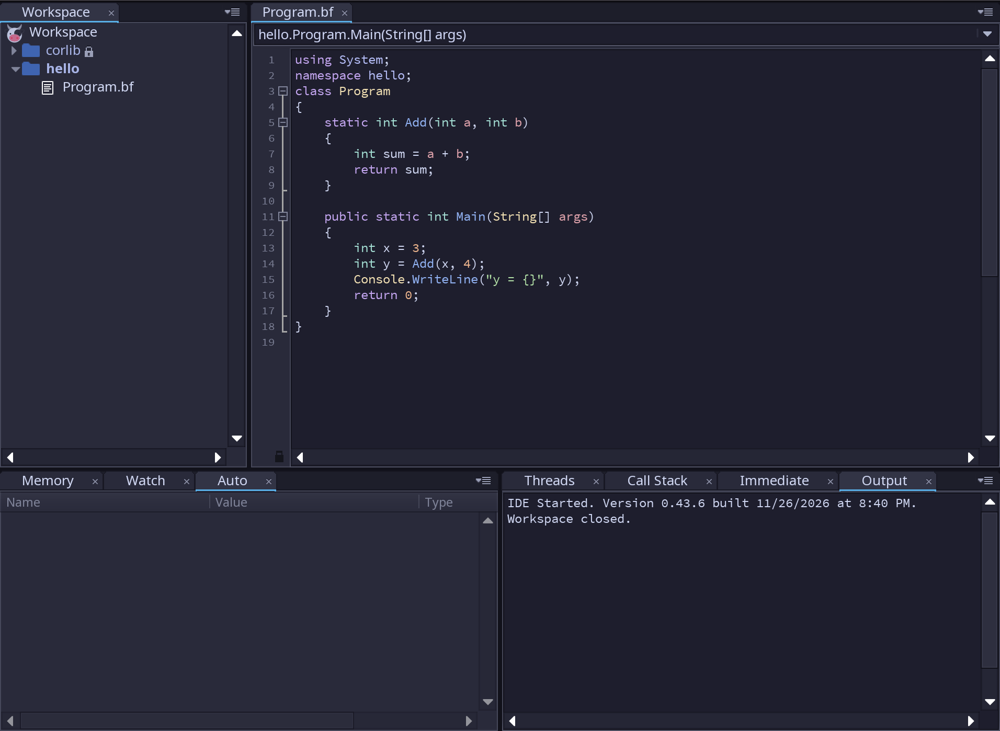

<h3 align="center">
   <br />
  Catppuccin theme for <a href="https://github.com/beefytech/beef">Beef IDE</a>
</h3>



## Previews

<details>
<summary>Latte</summary>

</details>

<details>
<summary>Frappe</summary>

</details>

<details>
<summary>Macchiato</summary>

</details>

<details>
<summary>Mocha</summary>

</details>

## Installation

### PowerShell
```ps
irm https://raw.githubusercontent.com/RogueMacro/cowppuccin/main/scripts/install.ps1 | iex
```

### Manual

1. Find your Beef installation path (`%BEEFPATH%`, typically `C:\Program Files\BeefLang` on Windows).
2. Create the directory `%BEEFPATH%\bin\themes` if it doesn't already exist.
3. Download the [latest release](https://github.com/roguemacro/cowppuccin/releases/latest/download/theme.zip) and unzip it into the `%BEEFPATH%\bin\themes\Cowppuccin` directory. Or alternatively clone the git repository.
4. Open the Beef IDE and go to **Settings > UI > General > Theme** and set its value to `Cowppuccin` or `Cowppuccin/<Latte|Frappe|Macchiato|Mocha>`. **Mocha** is the default, but to choose another, i.e. **Frappe**, you can specify `Cowppuccin/Frappe` instead.